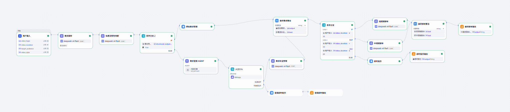
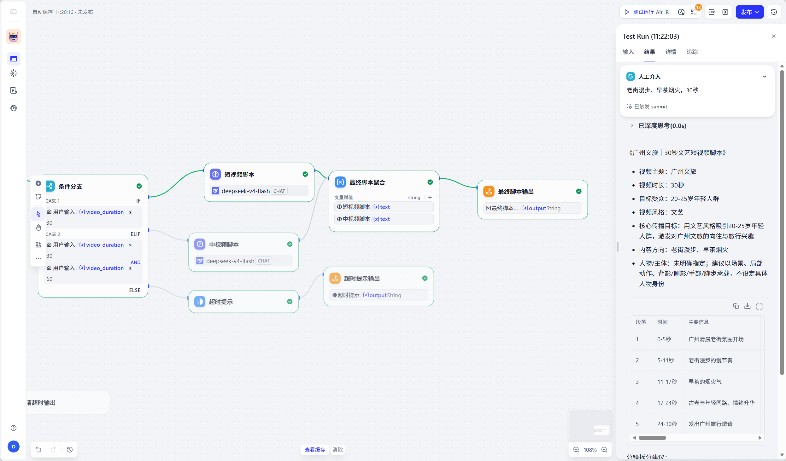
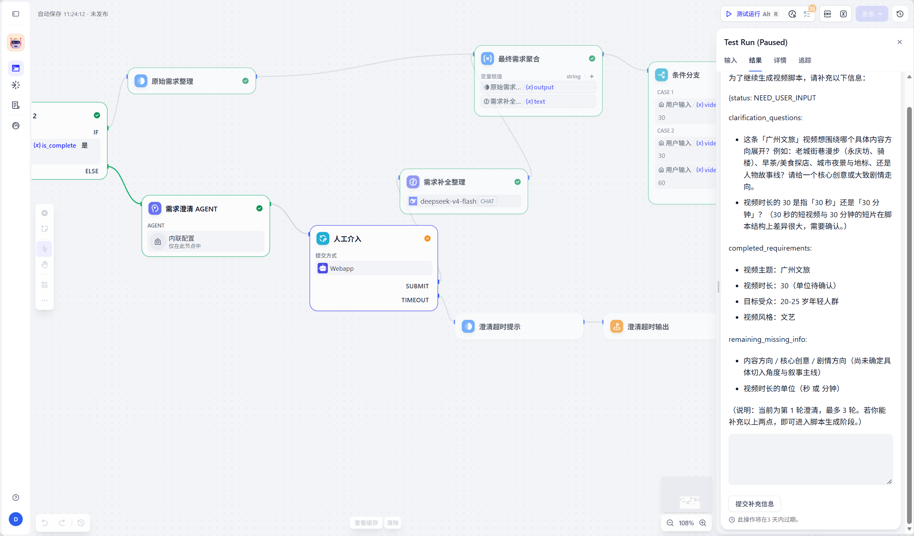

# AI Video Copilot

一个面向 AI 视频创作者的轻量级 Copilot Demo。

当前版本聚焦于：
**收集用户的视频创作需求，并将自然语言需求整理成结构化的视频参数，为后续接入 AI Model / Agent / Workflow 做准备。**

---

## Why｜为什么做

在 AI 视频创作过程中，用户往往只有一个比较模糊的想法。

例如：

> “我想做一个 30 秒的广州文旅视频，要有电影感。”

但真正进入 AI 视频生成流程时，还需要进一步明确：

- 视频主题
- 视频时长
- 视频风格
- 目标受众
- 内容方向

因此，我希望通过 AI Video Copilot 降低从“想法”到“可执行视频需求”的整理成本。

---

## User｜目标用户

主要面向：

- AI 视频初学者
- 短视频内容创作者
- AIGC 创作者
- 需要快速整理视频创意需求的用户

---

## Problem｜用户问题

目前 AI 视频创作中存在几个典型问题：

1. 用户有想法，但不知道如何整理成结构化需求
2. 不清楚视频生成前需要提供哪些关键信息
3. Prompt 和参数整理有一定学习成本
4. 从创意到脚本之间需要反复整理需求

---

## Solution｜解决方案

AI Video Copilot 将用户的视频需求拆分成结构化参数，例如：

```json
{
  "video_topic": "广州文旅",
  "video_duration": 30,
  "video_style": "电影感",
  "target_audience": "20-30岁年轻游客"
}
```
---

## Demo Evidence｜项目证据

### 1. Workflow｜完整工作流

下图展示 AI Video Copilot 当前真实 Workflow，包括需求解析、信息完整性判断、需求澄清、时长分支以及最终脚本生成。



---

### 2. 参数完整｜成功生成脚本

当用户提供完整的视频需求后，Workflow 可以正常执行并生成最终视频脚本。



---

### 3. 参数缺失｜主动澄清需求

当用户没有提供完整参数时，系统不会直接猜测，而是进入需求澄清流程，向用户询问缺失的信息。



---

### 4. Test Cases｜测试记录

👉 [查看完整测试记录](docs/test-cases.md)

---